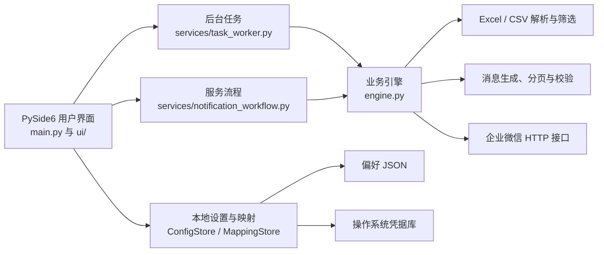

# 企业微信活动通知工具

> 面向 Excel 活动数据的本地桌面处理与企业微信通知工具。支持导入、动态筛选、记录与字段选择、消息预览、自动拆分校验，以及通过企业微信群机器人或企业自建应用发送通知。

**项目仓库：** [charminglover/WeComActivityNotifier](https://github.com/charminglover/WeComActivityNotifier)

**当前版本：** 3.0

**运行平台：** Windows 10/11（便携文件夹版）；开发与测试环境支持 PySide6

---

## 项目介绍

企业活动数据通常以 Excel 表格维护。将数据整理成可读的通知、按业务条件筛选、选择目标记录并发送到企业微信，往往需要重复手工操作，也容易遇到格式超限、错选对象或接收目标配置错误等问题。

本项目把这条工作流程整合到一个桌面应用中：用户导入自己的 Excel 或 CSV 文件，基于实际表头设置筛选条件，勾选要处理的记录与通知字段，检查自动生成的消息，再确认发送。数据解析、筛选、图片或 Markdown 消息生成以及企业微信接口调用由独立业务模块负责；PySide6 界面通过后台任务执行耗时工作，降低大数据操作期间的界面阻塞。

应用不会预设某个行业的表头或筛选字段。未导入文件时不展示业务列；导入后，表格列、筛选字段和可推送字段都根据文件内容生成。

## 设计目标

- **通用导入：** 适配不同表头的 Excel 与 CSV 数据，不将特定模板字段写死在界面中。
- **可控发送：** 发送前预览并验证整批消息与接收目标，降低错发、漏发和超限风险。
- **交互响应：** 使用虚拟化表格模型和后台任务处理大部分耗时操作，避免为每条记录创建控件。
- **易于维护：** 按界面、服务流程、数据处理和存储职责拆分代码，控制模块之间的依赖。
- **本地优先：** 导入文件与应用设置保存在本机；只有用户明确确认发送时，所选数据才会提交给企业微信接口。

## 主要功能

### 导入与动态数据表格

- 支持 `.xlsx`、`.xlsm`、`.xls` 和 `.csv`。
- Excel 工作簿可包含多个工作表；CSV 支持 UTF-8 与 GB18030 编码。
- 在工作表前 15 行内识别表头。优先识别常见表头特征；通用表格则根据前部行的内容密度选择候选表头。
- 表格列名来自导入文件；没有数据文件时不会显示预设的业务列。
- 首次加载后，列宽按表头和抽样数据自适应；用户可拖动表头边界手动调整，也可用工具栏或表头菜单重新调整。
- Excel 公式按文件保存的计算结果读取。若公式没有缓存结果，请先用 Excel 或兼容软件计算并保存。

### 筛选与记录选择

- 可针对任意导入列添加筛选条件，多条条件按 AND 组合。
- 文本列支持包含、不包含、等于、不等于和空值判断；数字列支持比较运算和空值判断。
- 支持逐条勾选、反选当前筛选结果、勾选筛选结果、取消勾选，以及勾选表格中高亮的行。
- 表格采用 `QTableView` 与自定义数据模型，只按需绘制视口内单元格；不会为整张表格创建成千上万个独立控件。
- 批量勾选后仅刷新当前视口内的记录，其他行滚动进入视口时会呈现其最新勾选状态。

### 通知内容与发送

- 选择需要发送的 Excel 字段，并调整字段顺序。
- 支持图片表格和 Markdown V2 表格。自建应用消息使用图片表格；Markdown V2 表格适用于群机器人。
- 图片表格在后台生成 JPEG，检查编码后的实际体积和图片尺寸；超限时自动拆分并重新验证。
- Markdown 消息按 UTF-8 实际字节数拆分，并在拆分后重复表头和分页信息。
- 可选择任意导入列进行分组，并在标题中使用 `{group_field}`、`{group_value}` 模板变量。
- 可按任意文本或数值条件标注消息中的记录；首次导入时推送字段默认全部未勾选。
- 发送前可预览消息内容和预计发送条数。图片预览可保存为与实际发送内容一致的 JPEG。
- 群机器人消息之间设置 3.2 秒间隔；可以停止后续尚未开始的发送。

### 服务店接收映射

服务店映射可在软件的“管理映射”窗口中添加、编辑、删除和保存，无需先自行制作 CSV。旧版映射 CSV 仍可导入。

映射按发送方式分别管理：

- 群机器人模式：服务店编码对应 Webhook。
- 自建应用模式：服务店编码对应接收人 UserID。

开启映射后，发送前会检查每条记录是否存在对应服务店目标；存在缺失时会阻止整批发送。群机器人模式还会校验映射中的 Webhook 是否符合企业微信官方地址格式。

## 使用流程

1. 启动应用，在“选择文件”中导入 Excel 或 CSV。
2. 在数据页添加需要的筛选条件并执行筛选，然后勾选目标记录。
3. 在内容页勾选通知字段、调整顺序，并设置消息标题模板、分组字段、发送格式及可选标注条件。
4. 在发送页选择群机器人或自建应用；如需按服务店发送，先打开“管理映射”并配置目标。
5. 选择“校验并预览消息”，检查内容和预计消息数。
6. 点击“确认并发送”，确认目标与记录数量后开始发送。
7. 发送过程中可停止尚未开始的后续消息；关闭窗口时，应用会请求取消后台任务。

> **发送对象说明：** 群机器人发送到配置该机器人的群，不能代替服务店的一对一私聊。发送前请确认 Webhook、UserID、服务店编码及所选数据正确。企业微信接口能否接收消息还取决于网络、应用权限、密钥状态和服务端限流策略。

## 技术架构



### 模块职责

| 模块 | 主要职责 |
|---|---|
| `main.py` | 创建主窗口、组装页面、连接用户操作与后台任务结果。 |
| `ui/table_model.py` | 虚拟化表格模型和记录勾选交互，负责单元格显示及单击切换复选框状态。 |
| `ui/filter_condition.py` | 根据导入文件中的实际字段创建动态筛选控件。 |
| `ui/mapping_dialog.py` | 提供服务店映射的应用内查看、添加、编辑、删除和 CSV 导入界面。 |
| `services/task_worker.py` | 在 Qt 工作线程中运行任务，传递结果、错误、进度和取消状态。 |
| `services/notification_workflow.py` | 负责选中记录的消息准备与接收目标校验，不依赖界面控件。 |
| `services/config_store.py` | 对非敏感用户偏好进行版本化、原子 JSON 读写。 |
| `services/mapping_store.py` | 保存服务店编码等映射元数据，并通过系统凭据库保存目标值。 |
| `engine.py` | 负责 Excel/CSV 解析、通用条件筛选、通知内容生成、拆分校验与企业微信请求。 |

界面层不直接实现消息分页或接口协议；引擎层不创建 Qt 控件。后台工作通过信号返回 UI 线程更新视图，避免由工作线程直接操作 Qt 界面对象。

## 性能与响应性

前期排查发现，卡顿并非只来自表格绘制，主要风险点包括：

1. 旧退出逻辑会在 UI 线程同步等待后台任务，等待上限为 18 秒。
2. 表格批量勾选后会通知整个数据范围更新，数据量越大，视图重绘负担越高。
3. 大文件导入和筛选需要遍历大量 Python 对象；如果不能取消任务，切换操作或退出时会感觉被卡住。
4. 自动列宽若对所有单元格逐一测量，也会随行数和列数增长而增加交互耗时。

当前版本已采取以下措施：

- 导入、筛选、批量选择、消息预览、发送校验和网络发送通过独立的 `QThreadPool` 任务执行。
- 导入和筛选任务支持取消检查；应用退出时异步请求停止任务，不再在关闭事件中等待固定时长。
- 对话框显示和消息预览只在任务完成后执行；工作线程不直接修改 UI 控件。
- 大表格使用虚拟模型，批量选择只发出当前视口范围的数据更新信号。
- 列宽自适应只抽样最多 80 条可见数据，并限制极长文本的测量长度；首次导入自动适配，后续筛选保留用户的手动列宽设置。

### 性能验证记录

在开发机上，以 15 万条合成记录对 `engine.filter_records` 进行筛选，单次条件筛选约 **0.14 秒**；筛选期间周期性后台计时任务仍持续执行。此数字用于记录当前实现的合成数据基准，不代表所有硬件、Excel 文件结构或复杂筛选条件下的固定耗时。Windows GitHub Actions 还会检查打包后的窗口能够启动。

关闭应用时，已开始的企业微信 HTTP 请求无法在服务端处理中途撤销；应用会等待当前请求返回，网络请求超时设置为 15 秒，之后不再继续发送剩余消息。

## 本地配置与安全

应用采用“配置与凭据分开保存”的方式：

- **偏好设置：** JSON 文件保存字段勾选和顺序、标题模板、格式、通用分组字段、重点标注条件及发送类型。新导入字段默认不勾选；用户保存过选择后，后续导入按保存的字段名恢复。文件采用临时文件写入后原子替换，避免意外中断留下半截配置。
- **服务店映射：** JSON 只保存映射记录编号与服务店编码；Webhook 和 UserID 目标保存至系统凭据库。Windows 使用 Python `keyring` 提供的 Windows 凭据后端；其他支持的平台会使用对应系统凭据库。映射按群机器人和自建应用分别保存。
- **发送凭证：** Webhook、CorpID、应用 Secret 和 AgentID 不提交至仓库。当前直接填写的 Webhook 与自建应用凭证不会写入普通偏好 JSON。
- **业务数据：** Excel/CSV 记录在本地读取和筛选；用户确认发送后，所选记录会按配置提交到企业微信接口。项目不包含数据上传后台或定时发送服务。

Windows 上常见数据目录：

```text
%APPDATA%\WeComActivityNotifier\
├─ preferences.json
├─ mappings-webhook.json
└─ mappings-userid.json
```

凭据目标由系统凭据库独立管理，不会以明文写在上述映射 JSON 文件中。不要把真实凭据、含有真实数据的 Excel 文件或用户配置提交到 GitHub。

## Windows 便携版构建与下载

### 下载 GitHub Actions 构建产物

每次推送至 `main` 后，GitHub Actions 会自动测试并构建 Windows 便携文件夹版；也可在仓库的 **Actions → Build Windows EXE → Run workflow** 手动触发。

1. 打开仓库的 [Actions 页面](https://github.com/charminglover/WeComActivityNotifier/actions)。
2. 进入最近一次成功的 **Build Windows EXE** 工作流运行。
3. 在页面底部下载 `WeComActivityNotifier-Windows-Portable`。
4. 解压后保留整个 `WeComActivityNotifier` 文件夹，运行其中的 `WeComActivityNotifier.exe`。

这是 **onedir 文件夹版**，不是把所有依赖塞进单一 EXE 的 onefile 版本。Qt、Python 运行库及其他依赖与启动文件一起放在目录中。目标 Windows 电脑不需要另行安装 Python；请勿只复制 EXE 文件。

工作流会执行单元测试、构建目录版、检查窗口启动、生成 `SHA256.txt` 并上传 ZIP。Actions 产物保留 14 天；长期分发时可为稳定版本创建 GitHub Release。

### 在 Windows 本机构建

需要 Python 3.11 或 3.12、网络连接和 Windows Python Launcher。克隆仓库后，在项目目录双击 `build_windows.bat`。脚本会安装依赖、运行测试并生成：

```text
dist\WeComActivityNotifier\
├─ WeComActivityNotifier.exe
├─ SHA256.txt
└─ _internal\...  （PyInstaller 收集的运行依赖）
```

请分发整个 `WeComActivityNotifier` 目录。`SHA256.txt` 用于核对 EXE 文件与构建时哈希是否一致；哈希匹配只能确认文件与该构建结果一致，不能替代杀毒扫描或代码签名。

### 从源码运行

```powershell
python -m pip install -r requirements.txt
python main.py
```

开发环境建议使用 Python 3.11/3.12。依赖版本范围见 [`requirements.txt`](requirements.txt)。

## 测试与质量检查

运行测试：

```powershell
python -m unittest discover -s tests -v
```

当前测试覆盖：

- Excel 与通用列名解析、动态条件筛选。
- 图片与 Markdown 消息生成、实际大小检查及自动分页。
- 自建应用图片消息上传流程与企业微信请求行为。
- Qt 表格模型、单条记录鼠标勾选、筛选控件及列宽模式。
- 配置 JSON 与凭据存储分离，验证接收目标不会明文出现在映射文件中。

发送流程没有使用真实企业微信凭据执行线上集成测试。上线前请用授权的测试群或测试应用验证组织权限、接收范围、网络连接和消息展示效果。

## 使用限制与注意事项

- 若一条记录中的单个字段极长，即使自动拆分到单条记录仍可能超过图片尺寸或 Markdown 限制；此时会阻止整批发送，不会静默截断该字段。
- 自建应用模式当前使用图片表格；Markdown V2 表格用于群机器人模式。
- 群机器人接口可能按企业微信的服务端策略限流。应用设置的 3.2 秒间隔是客户端发送节奏控制，不保证所有环境都不会遇到限流。
- Excel 数据表中的每一行按一条源记录处理；不会自动将跨活动的任务台数去重为唯一车辆数。
- 图片模式依赖目标系统字体显示中文；Windows 运行时优先使用系统中文字体。
- 第一次运行的新构建可能触发 Windows SmartScreen 的未知发布者或低信誉提示。请确认下载来自本仓库 Actions，核对 SHA256，并使用 Windows 安全中心扫描；不要仅因提示而关闭安全软件。

## 后续改进方向

可根据实际使用反馈继续扩展：

- 增加大文件分页加载或磁盘型数据缓存，降低超大工作簿的峰值内存占用。
- 增加可复用筛选方案、发送配置方案和用户可控的配置导入/导出。
- 为 Windows 发布流程加入正式代码签名与 GitHub Release 版本管理。
- 在不影响隐私的前提下补充应用内性能诊断信息，便于定位不同用户环境中的慢操作。

以上属于可选演进方向，不代表当前版本已经实现。
